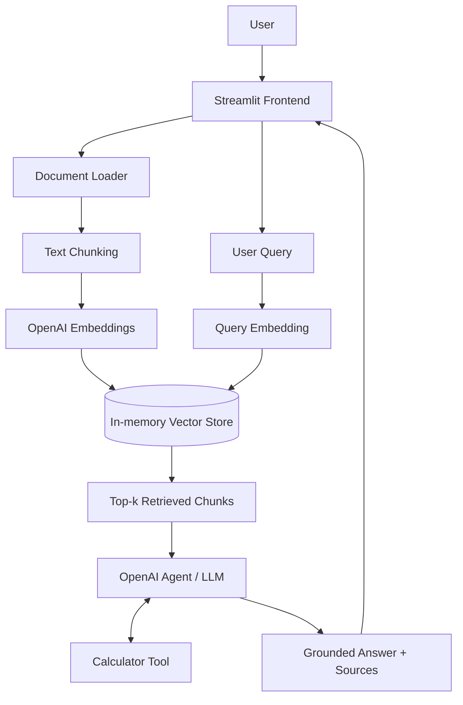

# Career & Research Copilot — GenAI Capstone

A Streamlit Generative AI application demonstrating:
- OpenAI chat-completions API integration
- Prompt engineering and grounded response instructions
- Retrieval-Augmented Generation (RAG) with OpenAI embeddings and cosine similarity
- Agent tool calling with a restricted arithmetic calculator
- PDF, DOCX, TXT and Markdown document ingestion
- Automated tests and GitHub Actions CI

## 1. Architecture



## 2. Run locally

Use Python 3.10 or newer.

```bash
python -m venv .venv
# Windows: .venv\Scripts\activate
# macOS/Linux:
source .venv/bin/activate

pip install -r requirements.txt
cp .env.example .env
```

Edit `.env` and set `OPENAI_API_KEY` to your newly generated key. Never commit `.env`.

```bash
streamlit run streamlit_app.py
```

Open the local URL printed by Streamlit (usually http://localhost:8501).

## 3. Use the application

1. Upload PDF, DOCX, TXT or MD files in the sidebar.
2. Select **Index uploaded documents**.
3. Ask questions about the uploaded content.
4. Ask for calculations to exercise the calculator tool.
5. Review source filenames included in document-grounded answers.

The starter uses an in-memory vector store. Uploaded content is not persisted and must be re-indexed after a session restart.

## 4. Deploy to Streamlit Community Cloud

1. Push this repository to GitHub.
2. Create a new app at https://share.streamlit.io/.
3. Select the repository, branch and `streamlit_app.py`.
4. In app settings, add secrets:

```toml
OPENAI_API_KEY = "your-new-key"
OPENAI_CHAT_MODEL = "gpt-4.1-mini"
OPENAI_EMBEDDING_MODEL = "text-embedding-3-small"
```

5. Deploy and test document upload, retrieval and tool calling.

Do not put secrets in source code, screenshots, README files or GitHub commits.

## 5. GitHub

```bash
git init
git add .
git commit -m "Build GenAI Career and Research Copilot"
git branch -M main
git remote add origin https://github.com/YOUR_USERNAME/genai-career-research-copilot.git
git push -u origin main
```

GitHub Actions runs pytest on pushes and pull requests.

## 6. Tests

```bash
pytest -q
```

## 7. Suggested enhancements

- Replace in-memory vectors with FAISS, Chroma or pgvector.
- Add authentication and per-user document isolation.
- Add persistent chat history and document metadata.
- Add a vetted web-search API tool for live research.
- Add retrieval evaluation (Recall@k, MRR) and answer evaluation.
- Add rate limits, usage monitoring, structured logs and error reporting.
- Add OCR for scanned PDFs and chunk-level access controls.

## 8. Security checklist

- Keep `.env` out of Git.
- Rotate any key that has been exposed.
- Use deployment secrets for hosted environments.
- Apply upload size limits and validate file types in production.
- Do not upload confidential documents unless authorized.
- Add authentication and data retention controls before public deployment.
